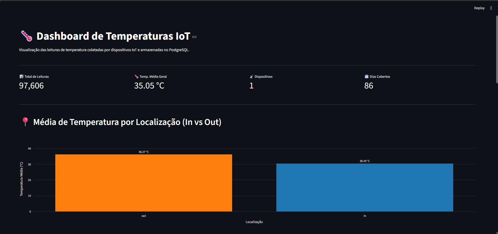
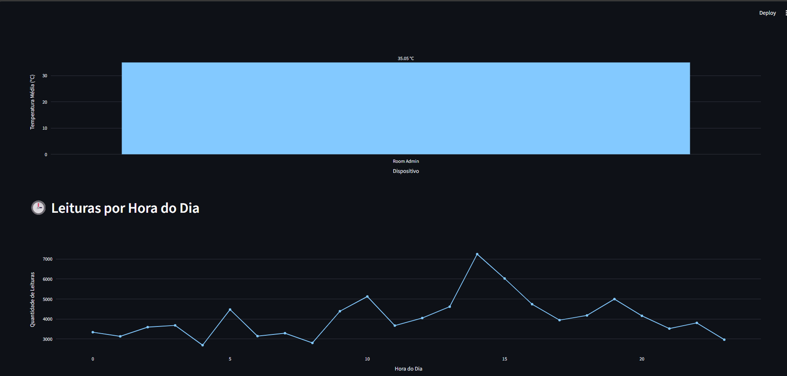
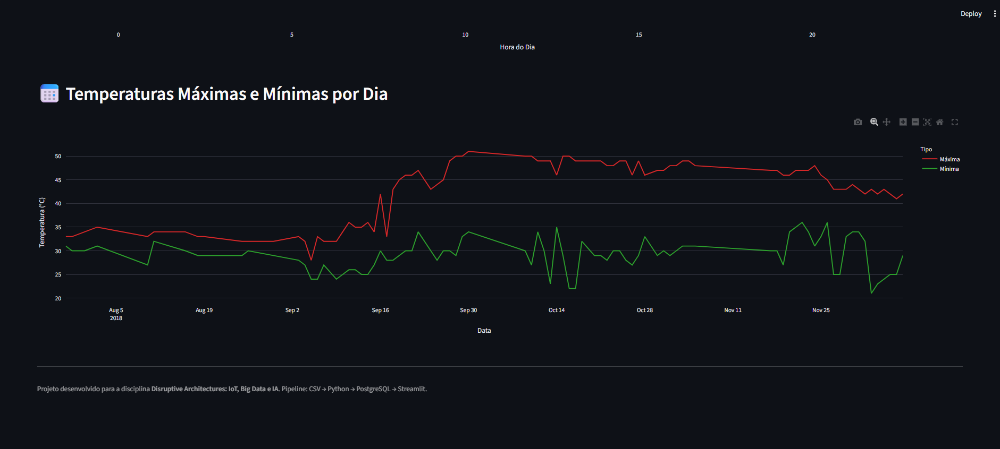

# 🌡️ Pipeline de Dados IoT com Docker, PostgreSQL e Streamlit

Projeto desenvolvido para a disciplina **Disruptive Architectures: IoT, Big Data e IA** do curso de **Análise e Desenvolvimento de Sistemas** da **UniFECAF-EAD**.

O objetivo é construir um **pipeline completo de dados** que processa leituras de temperatura de dispositivos IoT, armazena em um banco PostgreSQL (rodando em Docker) e exibe as informações em um dashboard interativo com Streamlit.

---

## 📋 Sumário

- [Sobre o projeto](#-sobre-o-projeto)
- [Tecnologias utilizadas](#-tecnologias-utilizadas)
- [Arquitetura do pipeline](#-arquitetura-do-pipeline)
- [Estrutura de pastas](#-estrutura-de-pastas)
- [Como executar o projeto](#-como-executar-o-projeto)
- [Views SQL](#-views-sql)
- [Dashboard](#-dashboard)
- [Insights obtidos](#-insights-obtidos)
- [Autor](#-autor)

---

## 🎯 Sobre o projeto

Dispositivos IoT (Internet das Coisas) geram uma enorme quantidade de dados continuamente. Este projeto simula um cenário real onde leituras de temperatura de sensores IoT são:

1. **Coletadas** a partir de um dataset público do Kaggle;
2. **Processadas** por um script Python (limpeza, conversão de tipos, geração de IDs);
3. **Armazenadas** em um banco PostgreSQL rodando dentro de um container Docker;
4. **Resumidas** em views SQL analíticas;
5. **Visualizadas** em um dashboard interativo feito com Streamlit + Plotly.

**Dataset utilizado:** [Temperature Readings: IoT Devices](https://www.kaggle.com/datasets/atulanandjha/temperature-readings-iot-devices) (97.606 leituras).

---

## 🛠 Tecnologias utilizadas

| Tecnologia | Função no projeto |
|---|---|
| **Python 3.14** | Linguagem principal dos scripts de ingestão e dashboard |
| **Pandas** | Leitura, tratamento e manipulação do CSV |
| **SQLAlchemy + psycopg** | Conexão do Python com o PostgreSQL |
| **Docker** | Isolamento do ambiente do banco de dados em container |
| **PostgreSQL 18** | Banco de dados relacional para armazenar as leituras |
| **Streamlit** | Criação do dashboard web interativo |
| **Plotly** | Geração dos gráficos interativos |
| **Git + GitHub** | Versionamento e publicação do código |

---

## 🏗 Arquitetura do pipeline

```
┌──────────────┐     ┌─────────────────┐     ┌──────────────────┐     ┌─────────────┐
│              │     │                 │     │                  │     │             │
│  CSV Kaggle  │────▶│  src/ingest.py  │────▶│   PostgreSQL     │────▶│  Streamlit  │
│  (IoT temp)  │     │  (Python)       │     │   (Docker)       │     │  Dashboard  │
│              │     │                 │     │   + 4 views SQL  │     │             │
└──────────────┘     └─────────────────┘     └──────────────────┘     └─────────────┘
```

**Fluxo:**
1. O CSV com 97.606 leituras é lido pelo script `ingest.py`
2. Os dados são limpos, tratados e inseridos no PostgreSQL
3. As views SQL consolidam os dados por dispositivo, localização, hora e dia
4. O Streamlit consome as views e gera o dashboard visual

---

## 📁 Estrutura de pastas

```
trabalho-iot-pipeline/
├── data/
│   └── IOT-temp.csv                # Dataset original (Kaggle)
├── docs/
│   ├── dashboard1.png              # Print do dashboard (KPIs + Gráfico 1)
│   ├── dashboard2.png              # Print do dashboard (Gráficos 2 e 3)
│   └── dashboard3.png              # Print do dashboard (Gráfico 4)
├── sql/
│   └── views.sql                   # Definição das 4 views SQL
├── src/
│   ├── ingest.py                   # Script de ingestão (CSV → PostgreSQL)
│   └── dashboard.py                # Dashboard Streamlit
├── venv/                           # Ambiente virtual (não versionado)
├── .gitignore                      # Arquivos ignorados pelo Git
├── requirements.txt                # Dependências do projeto
└── README.md                       # Este arquivo
```

---

## 🚀 Como executar o projeto

### Pré-requisitos

- **Python 3.10+** instalado ([python.org](https://www.python.org/))
- **Docker Desktop** instalado e em execução ([docker.com](https://www.docker.com/))
- **Git** instalado ([git-scm.com](https://git-scm.com/))

### Passo 1 — Clonar o repositório

```bash
git clone https://github.com/jeanwaiss/trabalho-iot-pipeline.git
cd trabalho-iot-pipeline
```

### Passo 2 — Criar e ativar o ambiente virtual

**Windows (PowerShell):**
```powershell
python -m venv venv
.\venv\Scripts\Activate.ps1
```

**Linux/macOS:**
```bash
python -m venv venv
source venv/bin/activate
```

### Passo 3 — Instalar as dependências

```bash
pip install -r requirements.txt
```

### Passo 4 — Baixar o dataset

Baixe o arquivo `IOT-temp.csv` do Kaggle:

👉 [Temperature Readings: IoT Devices](https://www.kaggle.com/datasets/atulanandjha/temperature-readings-iot-devices)

Salve o arquivo em `data/IOT-temp.csv`.

### Passo 5 — Subir o container PostgreSQL

```bash
docker run --name postgres-iot -e POSTGRES_PASSWORD=suasenha -p 5432:5432 -d postgres
```

### Passo 6 — Criar o banco e a tabela

```bash
docker exec -e PGPASSWORD=suasenha -it postgres-iot psql -U postgres -c "CREATE DATABASE iot_db;"
```

```bash
docker exec -e PGPASSWORD=suasenha -it postgres-iot psql -U postgres -d iot_db -c "CREATE TABLE IF NOT EXISTS temperature_readings (id BIGINT PRIMARY KEY, device_id VARCHAR(100), reading_datetime TIMESTAMP, temperature INTEGER, location VARCHAR(10));"
```

### Passo 7 — Ingerir os dados

```bash
python src/ingest.py
```

Saída esperada:
```
[1/4] Lendo o CSV: data/IOT-temp.csv
[2/4] Convertendo a coluna de data (formato DD-MM-YYYY)...
    -> 97606 linhas prontas para inserir.
[3/4] Conectando ao banco e inserindo os dados...
    -> 97606 linhas inseridas com sucesso!
[4/4] Concluído!
```

### Passo 8 — Criar as views SQL

```bash
docker cp sql/views.sql postgres-iot:/views.sql
docker exec -e PGPASSWORD=suasenha -it postgres-iot psql -U postgres -d iot_db -f /views.sql
```

### Passo 9 — Rodar o dashboard

```bash
streamlit run src/dashboard.py
```

O navegador abrirá automaticamente em `http://localhost:8501`.

---

## 🗄 Views SQL

O projeto cria **4 views** no PostgreSQL para resumir os dados de forma eficiente:

### 1. `avg_temp_por_dispositivo`

**Propósito:** calcular a temperatura média de cada dispositivo IoT.

```sql
CREATE OR REPLACE VIEW avg_temp_por_dispositivo AS
SELECT
    device_id,
    ROUND(AVG(temperature)::numeric, 2) AS avg_temp
FROM temperature_readings
GROUP BY device_id
ORDER BY avg_temp DESC;
```

**Uso:** permite comparar rapidamente o comportamento de diferentes dispositivos. Neste dataset, só há 1 dispositivo (`Room Admin`), com média de **35,05 °C**.

### 2. `leituras_por_hora`

**Propósito:** contar quantas leituras foram feitas em cada hora do dia (0–23).

```sql
CREATE OR REPLACE VIEW leituras_por_hora AS
SELECT
    EXTRACT(HOUR FROM reading_datetime)::int AS hora,
    COUNT(*) AS contagem
FROM temperature_readings
GROUP BY hora
ORDER BY hora;
```

**Uso:** identifica padrões de frequência de coleta ao longo do dia. Foi observado um pico às **14h (7.248 leituras)** e um vale às **4h (2.690 leituras)**.

### 3. `temp_max_min_por_dia`

**Propósito:** mostrar a temperatura máxima e mínima registrada em cada dia.

```sql
CREATE OR REPLACE VIEW temp_max_min_por_dia AS
SELECT
    DATE(reading_datetime) AS data,
    MAX(temperature) AS temp_max,
    MIN(temperature) AS temp_min
FROM temperature_readings
GROUP BY data
ORDER BY data;
```

**Uso:** permite visualizar a amplitude térmica diária e identificar dias atípicos.

### 4. `avg_temp_por_localizacao`

**Propósito:** comparar a temperatura média dentro e fora do ambiente (`in` vs `out`).

```sql
CREATE OR REPLACE VIEW avg_temp_por_localizacao AS
SELECT
    location,
    ROUND(AVG(temperature)::numeric, 2) AS avg_temp,
    COUNT(*) AS total_leituras
FROM temperature_readings
GROUP BY location
ORDER BY avg_temp DESC;
```

**Uso:** revelou uma diferença significativa entre ambientes internos e externos.

---

## 📊 Dashboard

O dashboard em Streamlit apresenta:

- **4 KPIs no topo:** total de leituras, temperatura média geral, número de dispositivos, dias cobertos;
- **Gráfico 1:** média de temperatura por localização (In vs Out) — gráfico de barras;
- **Gráfico 2:** média de temperatura por dispositivo — gráfico de barras;
- **Gráfico 3:** contagem de leituras por hora do dia — gráfico de linha;
- **Gráfico 4:** temperatura máxima e mínima por dia — gráfico de linha dupla.

### Capturas de tela

**Visão geral (KPIs + Gráfico 1):**



**Gráficos 2 e 3:**



**Gráfico 4:**



---

## 💡 Insights obtidos

A análise dos dados revelou alguns insights interessantes:

1. **Diferença entre ambientes internos e externos**
   - Temperatura média **externa (`out`)**: **36,27 °C**
   - Temperatura média **interna (`in`)**: **30,45 °C**
   - **Diferença de ~5,8 °C**, indicando que o ambiente interno é mais ameno.

2. **Pico de leituras às 14h**
   - Provavelmente relacionado ao horário de maior atividade dos sensores ou ao pico de temperatura diária.

3. **Vale de leituras às 4h da manhã**
   - Coerente com o período de menor atividade humana/máquina.

4. **Estabilidade térmica diária**
   - As temperaturas máxima e mínima por dia variam pouco (geralmente entre 27 °C e 35 °C), sugerindo um ambiente monitorado controlado.

### Sugestões de uso prático em ambiente real

- **Monitoramento preditivo:** alertar automaticamente quando a temperatura ultrapassar limites seguros;
- **Eficiência energética:** usar os dados para ajustar ar-condicionado/aquecimento de forma inteligente;
- **Análise de conforto térmico:** correlacionar temperatura com ocupação do espaço;
- **Manutenção de sensores:** detectar sensores com comportamento anômalo (leituras fora do padrão).

---

## 🔧 Comandos Git utilizados

```bash
git init
git add .
git commit -m "Projeto inicial: Pipeline de Dados IoT"
git branch -M main
git remote add origin https://github.com/jeanwaiss/trabalho-iot-pipeline.git
git push -u origin main
```

---

## 👤 Autor

**Jean Alexander Waiss Lima**

- Curso: Análise e Desenvolvimento de Sistemas
- Faculdade: UniFECAF-EAD
- Disciplina: Disruptive Architectures: IoT, Big Data e IA
- Tutor(a): Felipe Bonatto
- GitHub: [@jeanwaiss](https://github.com/jeanwaiss)

---

## 📄 Licença

Projeto desenvolvido para fins acadêmicos.